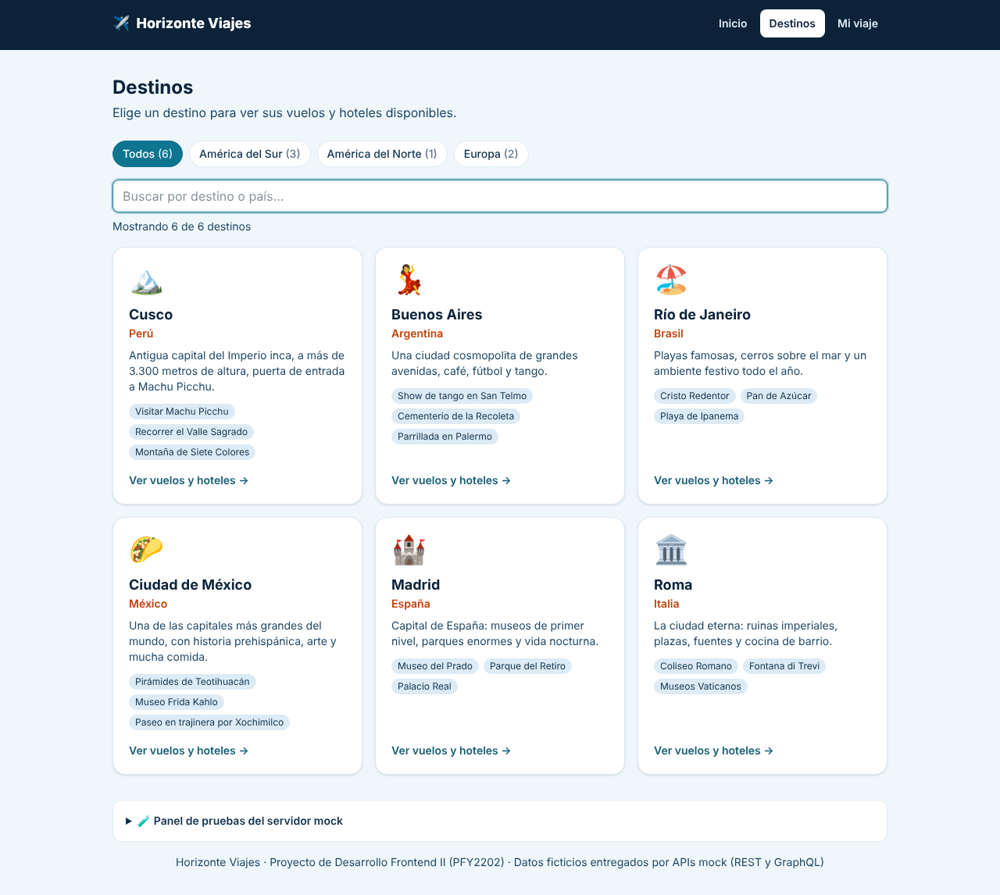
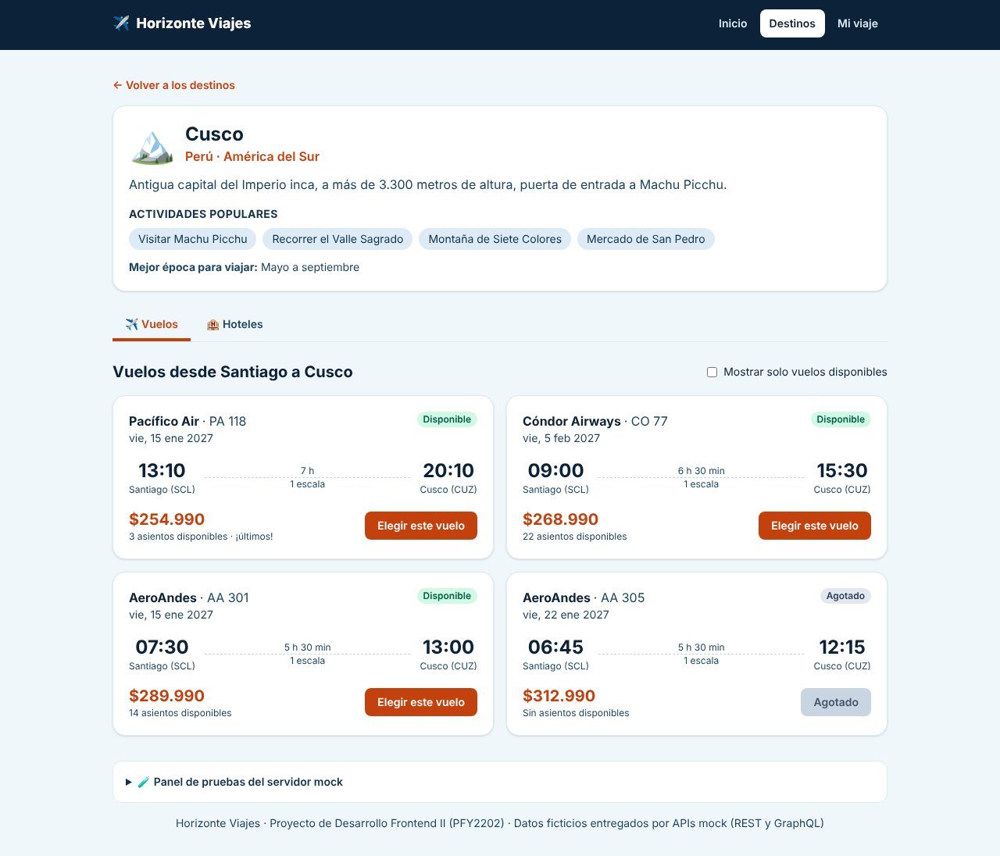
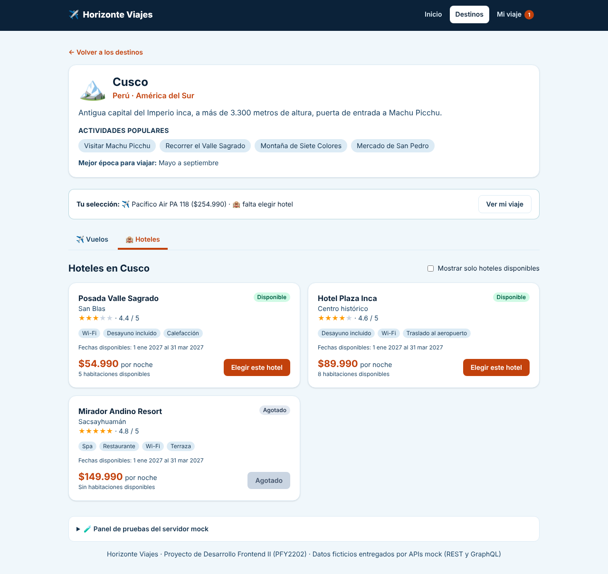
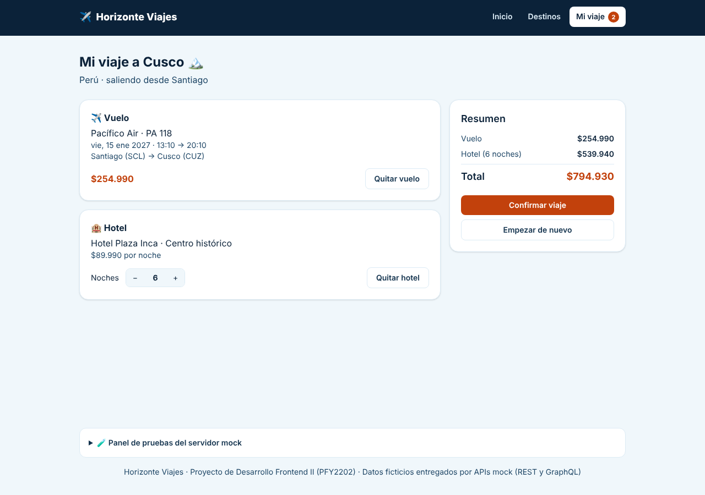
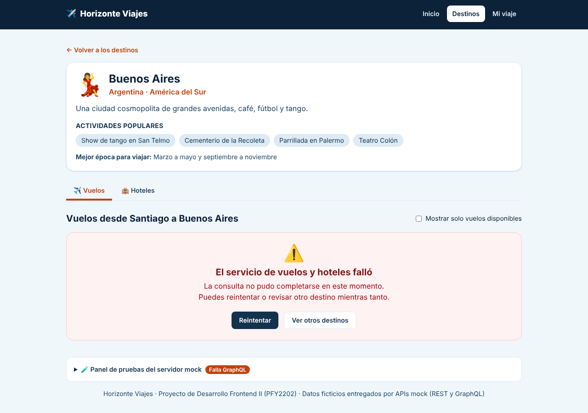
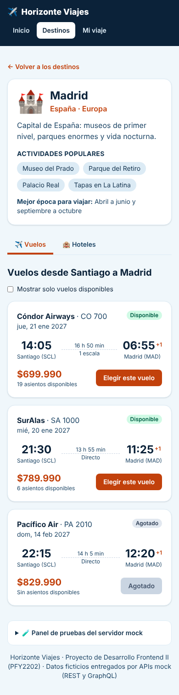

# Horizonte Viajes – Agencia de viajes con APIs REST y GraphQL mock

- **Curso:** Desarrollo Frontend II (PFY2202) · Duoc UC
- **Actividad:** Semana 5 (sumativa) – "Integrando nuestro frontend con backend"
- **Alumno:** Tomás Zúñiga
- **Repositorio:** `viajes-tomas-zuniga-PFY2202`

Aplicación web de una agencia de viajes hecha con **React**, **React Router** y **Tailwind CSS**. El usuario elige un **destino** y luego ve los **vuelos** y **hoteles** disponibles para armar su viaje y conocer el costo total.

Los datos no están escritos en los componentes: llegan por `fetch` desde dos backends **mock**:

- una **API REST** con los destinos (país y actividades populares);
- una **API GraphQL** con los vuelos y hoteles de cada destino (precios, fechas y disponibilidad).

> Todos los datos (aerolíneas, hoteles, precios y fechas) son **ficticios**.

## Capturas

| Destinos (REST) | Vuelos (GraphQL) |
|---|---|
|  |  |

| Hoteles (GraphQL) | Mi viaje |
|---|---|
|  |  |

| Falla de GraphQL con mensaje claro | Versión móvil |
|---|---|
|  |  |

## Páginas y rutas (React Router)

| Ruta | Página | API | Contenido |
|---|---|---|---|
| `/` | **Inicio** | REST | Presentación y 3 destinos destacados. |
| `/destinos` | **Destinos** | REST | Todos los destinos, con filtro por continente y buscador. |
| `/destinos/:id` | **Destino** | REST | País, descripción, actividades populares y mejor época. Redirige a `vuelos`. |
| `/destinos/:id/vuelos` | **Vuelos** | GraphQL | Vuelos con precio, fecha, duración, escalas y asientos disponibles. |
| `/destinos/:id/hoteles` | **Hoteles** | GraphQL | Hoteles con precio por noche, estrellas, servicios, fechas y habitaciones disponibles. |
| `/mi-viaje` | **Mi viaje** | — | Vuelo y hotel elegidos, noches y costo total. |
| cualquier otra | **Página no encontrada** | — | Mensaje con enlace al inicio. |

- `main.jsx` usa `HashRouter` (rutas con `#`), para que el sitio funcione al recargar en GitHub Pages.
- `Layout.jsx` define la estructura común con `<Outlet />`, y `MenuPrincipal.jsx` usa `<NavLink>` para marcar la opción activa.
- **Rutas anidadas:** `/destinos/:id` es una ruta padre cuyas pestañas **Vuelos** y **Hoteles** se dibujan en un `<Outlet context={{ destino }} />`. Las pestañas leen el destino con `useOutletContext`.
- La ruta índice `/destinos/:id` usa `<Navigate replace>` para abrir la pestaña de vuelos.
- `useParams` lee el `id` del destino, y la ruta comodín `*` muestra la página 404.

## API REST mock (destinos)

| Método | Ruta | Respuesta |
|---|---|---|
| `GET` | `/api/destinos` | `200` con la lista de destinos. |
| `GET` | `/api/destinos/:id` | `200` con el destino; `404` si no existe. |

Cada destino trae: `nombre`, `pais`, `continente`, `descripcion`, `actividades` (populares) y `mejorEpoca`.

## API GraphQL mock (vuelos y hoteles)

Un único endpoint `POST /graphql`. El servidor ejecuta de verdad cada consulta contra un **esquema** (`src/mocks/esquema.js`) con la librería `graphql`, así que valida los campos, usa variables y devuelve errores en el formato estándar.

```graphql
type Query {
  vuelos(destinoId: ID!, soloDisponibles: Boolean = false): [Vuelo!]!
  hoteles(destinoId: ID!, soloDisponibles: Boolean = false): [Hotel!]!
}
```

Consulta de vuelos (`src/servicios/consultas.js`):

```graphql
query Vuelos($destinoId: ID!, $soloDisponibles: Boolean) {
  vuelos(destinoId: $destinoId, soloDisponibles: $soloDisponibles) {
    id aerolinea numero origen destino salida llegada
    duracionMin escalas precio asientosDisponibles disponible
  }
}
```

- El cliente pide **solo los campos que la pantalla muestra**, y envía `$destinoId` y `$soloDisponibles` como **variables**.
- El interruptor "Mostrar solo vuelos/hoteles disponibles" cambia la variable `soloDisponibles` y vuelve a consultar.
- Si el destino no existe, la respuesta trae `errors` con el código `NOT_FOUND`; si la consulta es inválida, trae el mensaje de validación.

## Cómo funcionan los servidores mock

Se simulan con **MSW (Mock Service Worker)**: un Service Worker intercepta las peticiones `fetch` del navegador y responde como lo haría un backend real, con códigos HTTP y JSON. La aplicación usa `fetch` normal, y las peticiones se ven en la pestaña *Network* del navegador. Así **no hace falta levantar ningún servidor** aparte, y funciona igual en GitHub Pages.

- Datos: `src/mocks/datos.js` (6 destinos, 18 vuelos y 18 hoteles).
- Rutas REST y endpoint GraphQL: `src/mocks/handlers.js`. Cada respuesta demora unos 700 ms para simular un servidor real.
- Si el navegador no permite Service Workers (por ejemplo, una ventana privada de Firefox), la aplicación igual se muestra y avisa con un mensaje.

### Panel de pruebas

En el pie de página hay un **Panel de pruebas del servidor mock** para ver cómo reacciona la aplicación cuando algo falla (la página se recarga al elegir una opción):

| Opción | Qué simula |
|---|---|
| Normal | Las dos APIs responden bien. |
| Lento (4 s) | Cada respuesta demora 4 segundos. |
| Error 500 | La API REST y la GraphQL responden con un error interno. |
| Falla GraphQL | Solo vuelos y hoteles fallan (error dentro de la respuesta GraphQL); los destinos siguen funcionando. |
| Sin conexión | Las peticiones fallan como si no hubiera internet. |
| No responde | El servidor nunca responde: a los 8 segundos se corta la espera. |

## Manejo de estado (useState, useEffect y Context)

- `useState`: filtros y buscador (`Destinos.jsx`), interruptor de disponibilidad (`Vuelos.jsx`, `Hoteles.jsx`) y confirmación del viaje (`MiViaje.jsx`).
- `useEffect`: `useConsulta.js` pide los datos cuando cambia la consulta y evita actualizar el estado si el componente ya cambió de página; `ViajeContext.jsx` guarda el viaje en el navegador; `Layout.jsx` actualiza el título de la pestaña.
- **Context API:** `ViajeContext` comparte el viaje (destino, vuelo, hotel y noches) entre el detalle del destino, el menú y la página **Mi viaje**. Elegir algo de otro destino empieza un viaje nuevo.
- La interfaz se actualiza al instante: la insignia del menú, la tarjeta "elegida", el aviso "Tu selección" y el total cambian al elegir o quitar.

## Carga y errores

- Los hooks `useApi` (REST) y `useGraphQL` (GraphQL) devuelven `datos`, `cargando`, `error` y `reintentar`. El componente `Peticion` decide qué dibujar según ese estado.
- **Carga:** indicador por sección con esqueletos de tarjetas, y una barra global bajo el encabezado mientras haya cualquier petición en curso. Después de 8 segundos sin respuesta se corta la espera.
- **Errores:** cada falla (sin conexión, tiempo agotado, 404, 500 o error de GraphQL) tiene su propio mensaje claro, y un botón **Reintentar** cuando sirve (no en un 404).
- **Solución alternativa:** si una consulta falla pero ya se había cargado antes, se muestran los últimos datos guardados con un aviso.
- **Eficiencia:** caché en memoria de 5 minutos, peticiones idénticas compartidas, y vuelos y hoteles se consultan solo al abrir cada pestaña. Volver a una pestaña ya vista no repite la consulta ni muestra "cargando".

## Estructura del proyecto

```
.
├── index.html
├── package.json
├── vite.config.js
├── docs/capturas/                   Capturas usadas en este README
├── public/
│   └── mockServiceWorker.js         Archivo del servidor mock (lo genera MSW)
└── src/
    ├── main.jsx                     Enciende los mocks y dibuja la app (HashRouter)
    ├── App.jsx                      Rutas (incluye rutas anidadas)
    ├── estilos.js                   Clases de Tailwind reutilizables
    ├── utils.js                     Formato de precios, fechas y duraciones
    ├── mocks/
    │   ├── datos.js                 Destinos, vuelos y hoteles
    │   ├── esquema.js               Esquema GraphQL
    │   ├── graphql.js               Resolvers y ejecución de consultas GraphQL
    │   ├── handlers.js              Endpoints REST y GraphQL
    │   ├── modo.js                  Modos de prueba (error 500, lento...)
    │   └── browser.js               Arranque del servidor mock
    ├── servicios/
    │   ├── api.js                   fetch REST y GraphQL, errores, caché y respaldo
    │   ├── consultas.js             Consultas GraphQL
    │   └── estadoCarga.js           Contador de peticiones en curso
    ├── context/
    │   └── ViajeContext.jsx         Estado global del viaje
    ├── hooks/
    │   ├── useConsulta.js           Lógica común de carga/error/datos
    │   ├── useApi.js                Pide datos a la API REST
    │   ├── useGraphQL.js            Pide datos a la API GraphQL
    │   ├── useViaje.js              Lee y modifica el viaje
    │   └── useCargaGlobal.js        Cuántas peticiones hay en curso
    ├── components/
    │   ├── Layout.jsx               Encabezado, <Outlet /> y pie
    │   ├── MenuPrincipal.jsx        Menú con insignia de "Mi viaje"
    │   ├── IndicadorCarga.jsx       Barra de carga global
    │   ├── Cargando.jsx             Carga por sección
    │   ├── MensajeError.jsx         Errores con alternativas
    │   ├── AvisoRespaldo.jsx        Aviso de datos guardados
    │   ├── Peticion.jsx             Decide qué mostrar según el estado
    │   ├── TarjetaDestino.jsx
    │   ├── TarjetaVuelo.jsx
    │   ├── TarjetaHotel.jsx
    │   ├── FiltroChips.jsx          Filtro por botones
    │   ├── ControlCantidad.jsx      Control − número +
    │   ├── InsigniaDisponibilidad.jsx
    │   ├── Estrellas.jsx
    │   ├── EstadoVacio.jsx
    │   └── PanelPruebas.jsx         Panel para simular fallas
    ├── pages/
    │   ├── Inicio.jsx
    │   ├── Destinos.jsx
    │   ├── DetalleDestino.jsx       Ruta padre con pestañas
    │   ├── Vuelos.jsx
    │   ├── Hoteles.jsx
    │   ├── MiViaje.jsx
    │   └── NoEncontrada.jsx         Ruta comodín (404)
    └── styles/
        └── app.css                  Tailwind y colores
```

## Diseño responsivo

Se usa **Tailwind CSS 4** con variantes responsivas (`sm:`, `lg:`). Las tarjetas pasan de una columna en el celular a dos en pantallas grandes, el menú se acomoda bajo el logo en pantallas angostas, y no hay desborde horizontal en anchos de 360 y 390 px.

## Pruebas en distintos navegadores

Se probó el flujo completo: destinos, filtro y buscador, vuelos y hoteles por GraphQL, variable de disponibilidad, elegir vuelo y hotel, cálculo del total, recarga de página, rutas anidadas, 404, y los escenarios de falla del panel de pruebas.

| Navegador | Resultado |
|---|---|
| Chromium 153 (automatizado con Playwright) | Funciona: flujo completo, escenarios de falla y móvil (360 y 390 px). |
| Google Chrome 153 (automatizado con Playwright) | Funciona: flujo completo. |
| Emulación de teléfono Pixel 7 (táctil) | Funciona: elegir un vuelo con toque. |
| Mozilla Firefox | Por verificar manualmente (ver lista de abajo). |
| Microsoft Edge | Por verificar manualmente (ver lista de abajo). |
| Safari | Por verificar manualmente (ver lista de abajo). |

**Compatibilidad esperada:** Tailwind CSS 4 requiere navegadores modernos (Chrome 111+, Edge 111+, Safari 16.4+, Firefox 128+). El proyecto no usa APIs experimentales: solo `fetch`, `localStorage`, Service Worker e `Intl`.

**Lista para verificar en otro navegador** (unos 3 minutos):

1. Abrir el sitio en una ventana normal (no privada) y ver las 6 tarjetas de destinos.
2. Entrar a Cusco: se ven las actividades y los vuelos. Marcar "solo vuelos disponibles" y comprobar que desaparece el agotado.
3. Elegir un vuelo, ir a Hoteles y elegir un hotel: la insignia de "Mi viaje" muestra 2.
4. En **Mi viaje**, cambiar las noches y confirmar que el total cambia.
5. Recargar la página en `/mi-viaje`: se conserva el viaje.
6. En el Panel de pruebas elegir **Error 500** y comprobar que aparece un mensaje claro.

## Instalación y uso

Requiere [Node.js](https://nodejs.org) 18 o superior.

```bash
npm install        # instala las dependencias
npm run dev        # modo desarrollo en http://localhost:5173
npm run build      # genera la carpeta dist para producción
npm run preview    # prueba la versión de producción
```


## Tecnologías

React 19 · React Router 7 · Tailwind CSS 4 · MSW (servidor mock) · GraphQL.js · Vite · JavaScript (ES6)
